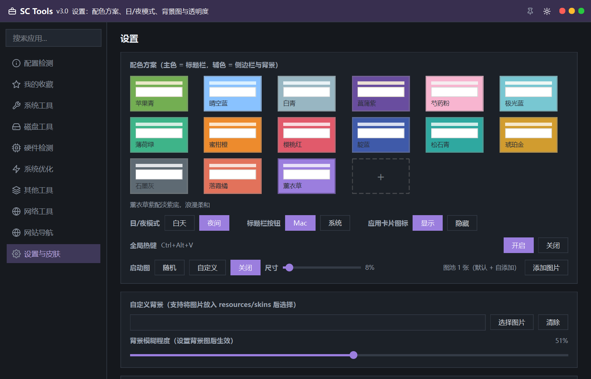
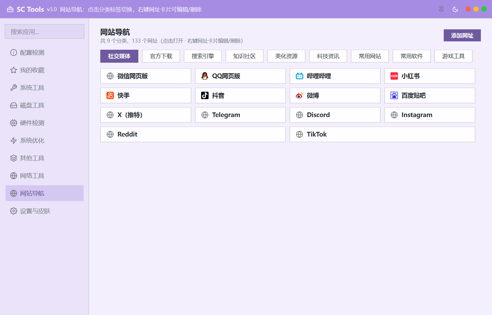
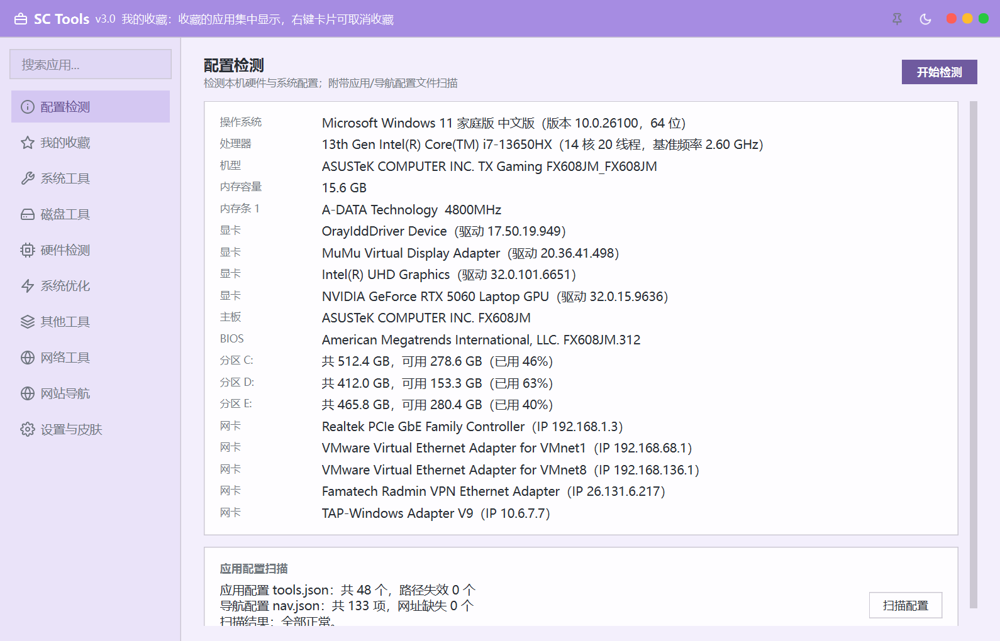
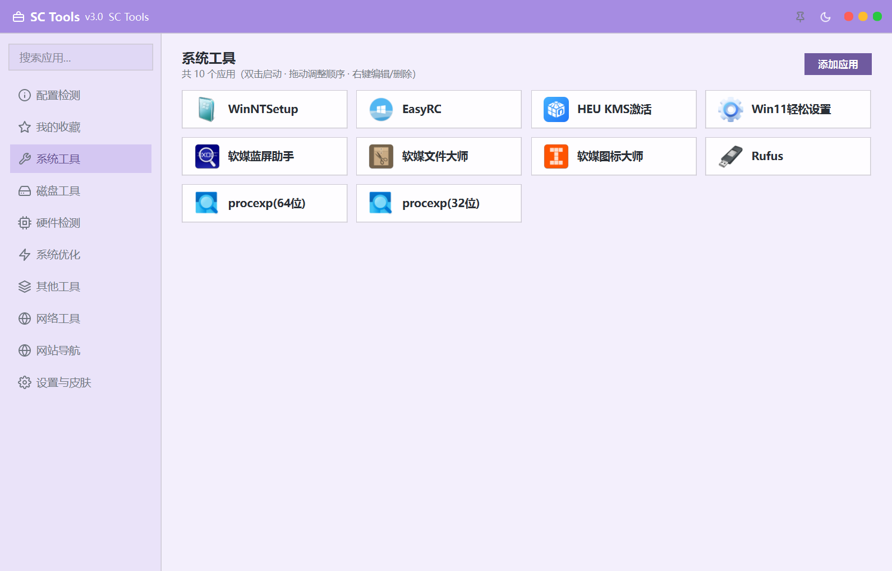
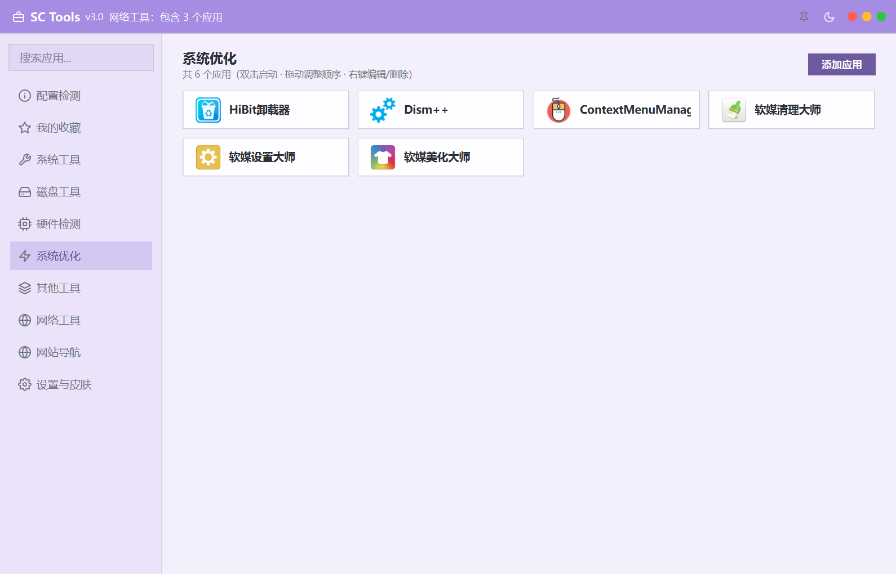
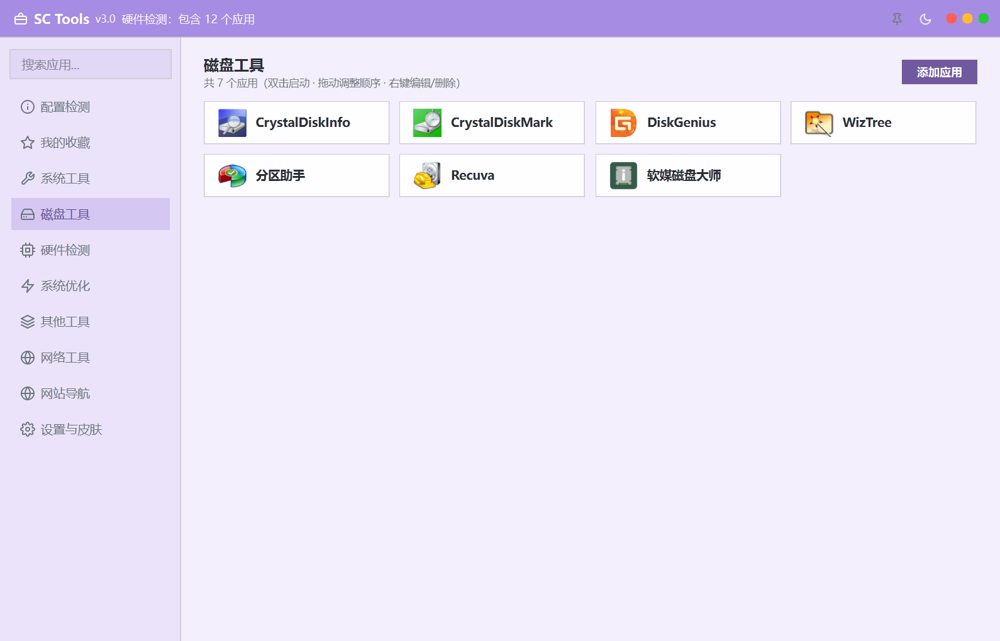
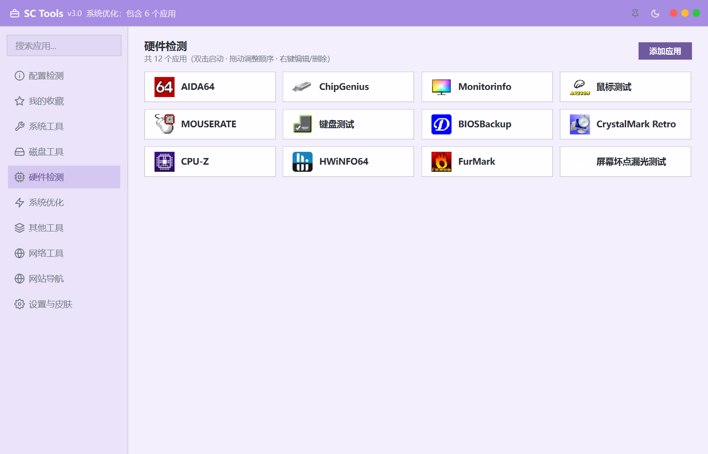
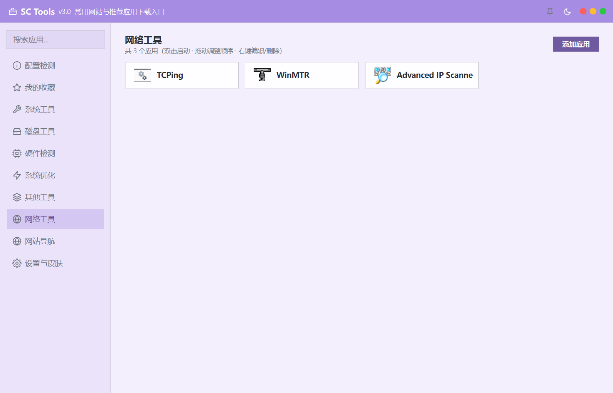
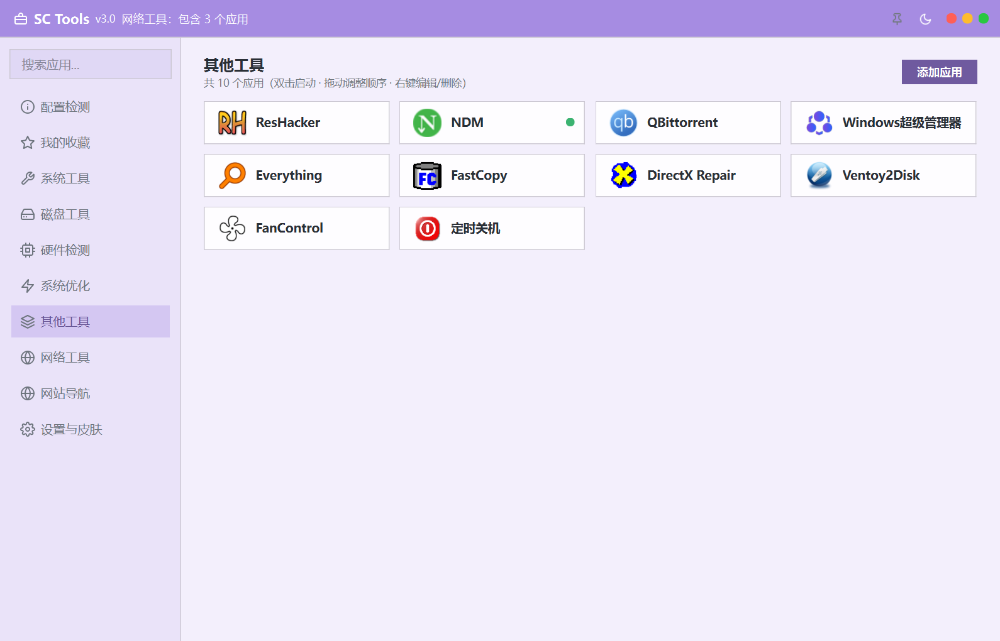

# SCTools2 工具箱

[](LICENSE)
[](https://www.python.org/)
[-41CD52.svg)](https://doc.qt.io/qtforpython/)

基于 **PySide6（Qt for Python）** 开发的 Windows 工具箱启动器，界面参考图吧工具箱。程序本身不包含第三方工具的功能实现，而是一个可扩展的管理与启动面板——第三方绿色软件放入 `tools/` 目录，由本程序统一分类、展示与一键启动。

> 仓库地址：<https://github.com/zhaogb612/SCTools_v2>

## 界面预览

|                工具箱（白天）                |                 工具箱（黑夜）                 |
| :-----------------------------------: | :-------------------------------------: |
|  |  |

|                  设置与皮肤                  |                    背景图设置                   |
| :-------------------------------------: | :----------------------------------------: |
|  |  |

|                网址导航               |                    配置检测                    |
| :-------------------------------: | :----------------------------------------: |
|  |  |

各分类工具箱页面：

|                    系统工具                    |                      系统优化                      |                   磁盘工具                   |                  硬件检测                  |                     网络工具                    |                    其他工具                   |
| :----------------------------------------: | :--------------------------------------------: | :--------------------------------------: | :------------------------------------: | :-----------------------------------------: | :---------------------------------------: |
|  |  |  |  |  |  |

## 功能特性

**工具箱**

- 可视化管理：界面内添加/编辑/删除应用卡片（可指向程序或目录），分类自定义（内置 6 类），配置存于 `resources/config/tools.json`

- 收藏与置顶：常用工具一键收藏，收藏视图独立入口

- 运行状态监测：正在运行的程序卡片显示绿点

- 卡片图标：自动提取程序真实图标（QFileIconProvider + ExtractIconExW 兜底 + 磁盘缓存），可在设置中开关

- 拖拽排序、右键菜单（启动 / 打开所在目录 / 收藏 / 编辑 / 删除）

**网站导航**

- 10 余个分组、130+ 精选站点（含游戏工具分组），favicon 自动抓取与缓存，右键可增删改

- 卡片填满式流式布局（末行自动拉伸占满整行）

**系统检测**

- 配置检测页：系统 / 处理器 / 内存 / 显卡 / 主板 / 硬盘 / 网络一览

- 内置「屏幕坏点漏光检测」：8 色全屏 + 自动轮播，纯自研无第三方依赖

**全局能力**

- 全局呼出热键：预设 5 组组合键，也支持按下任意「修饰键+主键」自定义（行内录制，无弹窗）

- 自动更新：对接 GitHub Releases，启动时检查、展示更新日志、下载安装包

- 启动图：GIF/静图展示（可点击跳过），图池随机或固定显示，尺寸滑条 5%–80% 自由调节，支持自添加图片

- 配置导入导出、一键恢复默认；误删配置文件可自动重置

**界面**

- 双色主题体系：15 套内置配色 + 自定义主题，日夜模式一键切换

- 面板不透明度可调、自定义背景图（支持模糊）

- 仿 Mac 标题栏（控制按钮居右）、直角卡片、统一自定义弹窗

- 全程无 emoji，界面图标为 feather 风格线性 SVG（内置定义，首次运行释放到 `resources/icons/`）

- 中文字体回退链 `Microsoft YaHei UI → Microsoft YaHei → PingFang SC → Noto Sans CJK SC → SimHei`

## 下载与安装

前往 [Releases](https://github.com/zhaogb612/SCTools_v2/releases) 页面获取安装包：

- **绿色版（`.7z`）**：解压到任意目录，双击 `SCTools2.exe` 即可运行，可整体搬移到 U 盘，免安装。

- **安装版（`.exe`）**：双击运行安装程序，按向导选择安装位置；会创建桌面与开始菜单快捷方式，并写入注册表卸载信息（控制面板「应用/卸载」可见），卸载时自动清理文件与注册表项。

> 说明：源码仓库不含第三方绿色工具（体积大且版权归原作者）。绿色版会携带一份整理好的 `tools/`；从源码运行或自行打包时，请将自己的工具放入 `tools/` 对应分类目录。

## 从源码运行

```bash
pip install -r requirements.txt
python main.py
```

需要 Python 3.10+ 与 `PySide6>=6.5`。

## 打包与安装程序

```bash
build.bat                        # PyInstaller 打包主程序，产物在 dist/SCTools2/
installer\build_installer.bat    # 生成单文件安装程序，产物在 dist_installer/
```

- 主程序为**平铺式 onedir**：exe 与运行库/资源/tools 全部同层（无 `_internal`），可整体搬移；`SCTools.spec` 已剔除未使用的 Qt 模块与 ffmpeg/OpenGL 软渲染等大体积二进制。

- 安装程序为 **onefile 双职能**（安装/卸载合一）：构建脚本把 `dist/SCTools2` 打成载荷 `payload.zip` 后直接拼接到安装器 exe 尾部，输出单文件安装包；安装时按向导解压载荷、创建快捷方式并写入卸载信息。

## 目录结构

```
SCTools2/
├── main.py                  # 入口（启动图 → 主窗口）
├── app/
│   ├── core/
│   │   ├── config.py        # 路径与 JSON 配置读写（含版本号 APP_VER）
│   │   ├── app_manager.py   # 应用管理（增删改查/启动/收藏/分类）
│   │   ├── nav_manager.py   # 导航管理（默认清单自动合并）
│   │   ├── file_icon.py     # 程序图标提取（三层兜底 + 磁盘缓存）
│   │   ├── favicon.py       # 网站 favicon 抓取与缓存
│   │   ├── hotkey.py        # Windows 全局热键（RegisterHotKey）
│   │   ├── updater.py       # GitHub Releases 自动更新
│   │   └── theme.py         # 双色主题调色板 + 全局 QSS
│   └── ui/
│       ├── icons.py         # SVG 图标定义与着色加载
│       ├── dialogs.py       # 统一弹窗基类 + 消息框（方角自定义标题栏）
│       ├── flow_layout.py   # 流式布局（填满式模式）
│       ├── title_bar.py     # 仿 Mac 标题栏
│       ├── main_window.py   # 主窗口（自绘背景/侧边导航/页面栈）
│       ├── tools_page.py    # 工具箱页
│       ├── tool_dialog.py   # 添加/编辑应用对话框
│       ├── nav_page.py      # 网站导航页
│       ├── check_page.py    # 配置检测页
│       ├── splash.py        # 启动图窗口
│       └── settings_page.py # 设置页（主题/热键/启动图/更新/导入导出）
├── tools/                   # 第三方绿色工具（自包含，不入库）
├── installer/               # 安装程序源码与构建脚本
├── docs/                    # 截图与规划文档
└── resources/
    ├── config/              # tools.json / nav.json / skin.json（运行时生成）
    ├── icons/               # SVG 图标（运行时释放）
    ├── splash/              # 默认启动图
    └── skins/               # 自定义背景图存放处
```

`tools/` 内含 6 个分类目录（`system_tools` / `system_optimization` / `disk_tools` / `hardware_detection` / `network_tools` / `other_tools`）与自研插件目录 `builtin/`（屏幕坏点检测等，动态加载）。

## 配置文件说明

- `tools.json`：分类与应用清单（name / category / description / path）

- `nav.json`：导航项（name / url / description / group）；默认清单随版本更新自动合并，已有项与删除记录不受影响

- `skin.json`：主题与外观（theme / bg\_image / opacity / blur / show\_tool\_icons 等）及功能开关（splash\_mode / splash\_ratio / hotkey\_label 等）；首次运行自动生成，含本机路径故不随仓库分发

用户运行期产生的图标缓存与自添加启动图位于 `%LOCALAPPDATA%\SCTools\`。直接备份整个 `resources/` 即可迁移配置。

## 第三方工具与免责声明

- 第三方工具版权归原作者所有，本项目仅提供启动入口与整理，未修改其程序本体；各工具条款以其官方协议为准。

- `tools/` 不参与开源分发；发布安装包/绿色版时请自行确认各工具的再分发许可。

- 本软件按「现状」提供，作者不对使用本软件造成的任何损失负责。详见安装包内「许可协议与免责声明」。

## 开源协议

本项目源码以 [MIT License](LICENSE) 开源发布，可自由使用、修改与分发（保留版权与许可声明即可）。随包携带的第三方工具不适用 MIT 协议。

## 更新日志

### v3.1

- 设置页新增「清除缓存」，清理程序图标与网页图标的提取缓存
- 「恢复默认配置」的出厂工具清单与随包配置对齐
- 标题栏系统样式按钮贴合原生观感；修复最大化后还原需点击两次的问题
- 安装程序在所选目录下自动创建 `SCTools2` 子目录，避免程序文件铺满所选目录
- 更新检测放宽安装包资产匹配，兼容中文资产名被截断的情况

### v3.0

- PySide6 重构版首发：工具箱 / 网站导航 / 配置检测 / 设置与皮肤四大模块

- 双色主题体系、日夜模式、背景图与自定义透明度

- 全局呼出热键行内录制、GitHub Releases 自动更新、配置导入导出

- 屏幕坏点漏光检测、启动图、应用真实图标提取

***

作者：沙尘612 · 2026
